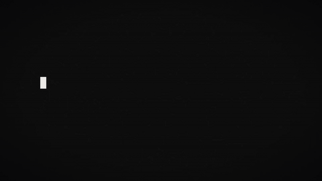

**English** | [简体中文](README_CN.md)

# Motionboard

Shot language from Apple and Linear launch films, rebuilt in code for your agent.

[](LICENSE)
[](#install)
[](#install)

[motionboard.app](https://motionboard.app) · [All recipes](https://motionboard.app/#recipes)

[](https://motionboard.app)

Motionboard breaks real launch films down into 38 shots. Each shot is recreated in code as a ~10 second [HyperFrames](https://github.com/heygen-com/hyperframes) film (HTML and GSAP rendered to video), and the website shows every original next to its recreation. The skill gives your agent all 38 recipes, so it can make one shot or plan and build a whole launch film for your product.

Requirements: Node 22+, HyperFrames (`npx hyperframes`), ffmpeg.

## Install

```sh
npx skills add krisyangdev/motionboard
```

Or hand the link to your agent:

> Install this skill: https://github.com/krisyangdev/motionboard

Manual install for Claude Code and Codex:

```sh
git clone https://github.com/krisyangdev/motionboard.git ~/motionboard
ln -s ~/motionboard/skills/motionboard ~/.claude/skills/motionboard
ln -s ~/motionboard/skills/motionboard ~/.codex/skills/motionboard
```

## Use

| Say | What happens |
| --- | --- |
| Make a launch film for my product with Motionboard. | The agent reads your product, proposes a 4 to 6 shot storyboard with preview links, waits for your OK, builds each shot and joins them into one MP4. |
| Use the match-cut recipe to go from my logo to the app. | The agent builds that one shot with your brand and UI, renders it, and checks it against the preview. |
| Make the Tilted UI with Depth of Field shot for this landing page. | The agent ports the recipe's GSAP timeline into your site as a hero animation. |

You can also copy one recipe's instruction from [motionboard.app](https://motionboard.app) and paste it into Claude Code. It needs no install.

## Recipes

38 recipes, grouped by where they sit in a launch film.

<!-- recipes:start -->

### Opening (7)

| Recipe | Shot |
| --- | --- |
| [Light Reveal](https://motionboard.app/recipes/light-reveal/) | The product emerges from pure black as exposure rises, with a barely perceptible push-in, and the closing shot runs the same move in reverse. |
| [Showcase Wall](https://motionboard.app/recipes/showcase-wall/) | A full-screen wall of work cards drifts diagonally at constant speed while slowly scaling up, then accelerates into one card at the end. |
| [Word-by-Word Highlight](https://motionboard.app/recipes/word-by-word-highlight/) | Words in a small centered line brighten from gray to white one at a time, and the text never moves. |
| [Rhythmic Typing](https://motionboard.app/recipes/rhythmic-typing/) | Monospace text is typed character by character with a cursor at uneven human speed, then deleted and retyped. |
| [Branching Growth](https://motionboard.app/recipes/branching-growth/) | A single dot branches layer by layer into a network, slow at first and then faster, or splits in doubling beats until it fills the frame. |
| [Iris Window Montage](https://motionboard.app/recipes/iris-window-montage/) | A fixed circular window cuts rapidly between images, or revisits the same image, while its size jumps with the rhythm. |
| [Line Boil](https://motionboard.app/recipes/line-boil/) | Hand-drawn outlines swap to a slightly different trace every few frames, and motion steps at a low frame rate with no tweening. |

### Product reveal (7)

| Recipe | Shot |
| --- | --- |
| [Device Push-in Focus](https://motionboard.app/recipes/device-push-in-focus/) | A line-art 3D laptop turns upright while closed, opens, pushes in on the keyboard, then pans from key to key in step with the option selected in the UI beside it. |
| [Macro Pull-out Reveal](https://motionboard.app/recipes/macro-pull-out-reveal/) | The camera drifts slowly across a surface at extreme close range, then one pull-back reveals the whole device or page. |
| [X-ray Dissolve](https://motionboard.app/recipes/x-ray-dissolve/) | The internal structure and the outer shell cross-dissolve from the same camera position, then the camera pulls back to the whole device. |
| [Text–Object Interleave](https://motionboard.app/recipes/text-object-interleave/) | Text and object interleave in depth: type rises from behind the product, a device slots into a gap in a sentence, or a word passes through an object and comes out as another word. |
| [Outline to Solid](https://motionboard.app/recipes/outline-to-solid/) | A wireframe or light-drawn outline appears first, then fills into a solid shape or material. |
| [Tilted UI with Depth of Field](https://motionboard.app/recipes/tilted-ui-with-depth-of-field/) | A UI plane tilted 10–15° and shot up close, with only the active row in focus and the rest blurred. |
| [Dock Arrival](https://motionboard.app/recipes/dock-arrival/) | A magnified Dock opens a gap, a new icon grows into it with one small spark, and a cursor click opens the window. |

### Features (15)

| Recipe | Shot |
| --- | --- |
| [Dispense Line-up](https://motionboard.app/recipes/dispense-line-up/) | Accessories slide out of the main object one by one into a row while the caption appears word by word, then retract in mirror order. |
| [Auto Zoom / Zoom-to-Cursor](https://motionboard.app/recipes/auto-zoom/) | The camera pushes to the target element in 0.4–0.8s, holds for one click or input, then pulls back to the full view. |
| [Morph Relay](https://motionboard.app/recipes/morph-relay/) | One element keeps morphing into the next, replacing cuts, so the whole sequence has no hard cut. |
| [Wireframe Re-layout](https://motionboard.app/recipes/wireframe-re-layout/) | Content fades to wireframes, the wireframes re-flow into a new layout, then each cell fills with new content in turn. |
| [Card Flip to Code](https://motionboard.app/recipes/card-flip-to-code/) | The preview card rotates 180° around the Y axis and its back face shows the code. |
| [Control-Driven Change](https://motionboard.app/recipes/control-driven-change/) | The frame a control (color picker, toggle, dial) lands, the page result changes on that same frame. It can be split-screen with the control on the left and the result on the right. |
| [Multiplayer Cursors](https://motionboard.app/recipes/multiplayer-cursors/) | Enlarged two-color named cursors move across a canvas, leave comments, and drag items to reorder. |
| [Focus Hop](https://motionboard.app/recipes/focus-hop/) | A highlight block or focus frame hops one cell at a time with the cursor, and the frame can take the color of the icon inside it. |
| [Pile-up and Clear](https://motionboard.app/recipes/pile-up-and-clear/) | Tasks, tags, or events pile up one by one until the screen is full, then clear in one step to a single result state. |
| [Prompt Carousel](https://motionboard.app/recipes/prompt-carousel/) | A line under the headline thickens into a pill, becomes an input box, and types a list of prompts that scroll vertically. |
| [Scattered Spec Type](https://motionboard.app/recipes/scattered-spec-type/) | A spec line is split into words placed far apart on uneven baselines, with a connector word stepping up letter by letter. |
| [Glass Lens](https://motionboard.app/recipes/glass-lens/) | A transparent glass disc, loupe, or control moves over content, magnifying and refracting what lies beneath, with dispersion at the edge. |
| [Map Pin Drop](https://motionboard.app/recipes/map-pin-drop/) | A pin drops onto a map with a bounce and bursts into fragments, the map zooms out to the whole country, and a route line draws to the next city. |
| [Dot-Matrix Glyph](https://motionboard.app/recipes/dot-matrix-glyph/) | A graphic is quantized onto a circular dot-matrix display, and every frame of its rotation or change snaps to the dot grid. |
| [Confirmation Burst](https://motionboard.app/recipes/confirmation-burst/) | On the frame of a tap, payment, or confirmation, lines, squares, and dots radiate from the contact point, or an icon pops with a bounce and an echo outline expands. |

### Transitions (5)

| Recipe | Shot |
| --- | --- |
| [Locked-Layout Reskin](https://motionboard.app/recipes/locked-layout-reskin/) | Layout positions stay locked while the color scheme and fonts hard-cut every 6–10 frames. |
| [Glass Droplet Split](https://motionboard.app/recipes/glass-droplet-split/) | A glass slab stretches into a droplet, its neck thins and breaks, leaving a round bead. A dispersive glass ring contracting inward is the sibling form. |
| [Domino Wave](https://motionboard.app/recipes/domino-wave/) | A row of cubes flips 90 degrees one after another with a phase offset, while the camera pans along the line. |
| [Match Cut](https://motionboard.app/recipes/match-cut/) | One object is replaced by another at the same anchor point, so the viewer's gaze never moves. |
| [Foreground Wipe & Flash](https://motionboard.app/recipes/foreground-wipe-flash/) | A defocused foreground object sweeps across and covers the frame to cut scenes, or a central glow blows out to white before the next scene. |

### Ending (4)

| Recipe | Shot |
| --- | --- |
| [Rotate to Lockup](https://motionboard.app/recipes/rotate-to-lockup/) | An object spins with a long ease-out and stops at the exact angle that forms the logo silhouette or the hero view of the product. |
| [Converge to Mark](https://motionboard.app/recipes/converge-to-mark/) | At the end, multiple elements gather and compress into a single icon or logo, always centered in the frame. |
| [Mark-to-Wordmark Unfold](https://motionboard.app/recipes/mark-to-wordmark-unfold/) | A logo mark sits centered, then the wordmark unfolds from behind it or outward from its center, optionally with a scramble-then-lock effect. |
| [Chromatic Stretch](https://motionboard.app/recipes/chromatic-stretch/) | Some letters of a wordmark stretch horizontally with RGB ghosting, distort in steps, then snap back clean. |

<!-- recipes:end -->

## Website

The site is TanStack Start prerendered to static HTML and served from Cloudflare Workers.

```sh
npm install
npm run dev        # http://127.0.0.1:3000
npm run build      # generate recipe files, prerender every page, write sitemap.xml
npm run deploy     # build, then cf deploy
```

`scripts/recipes.mjs` runs before each dev and build. It writes the agent-facing recipe files for the website (`public/r/`) and for the skill (`skills/motionboard/recipes/`) from `src/data/`, and copies `skills/motionboard/source/` to `public/source/`.

Films and posters are served from R2 at https://media.motionboard.app. Keep source files in `media/` (not tracked) and upload with `scripts/upload-media.sh [file ...]`. Copy, like and wish counts live in D1; apply the schema locally once with `npx wrangler d1 migrations apply DB --local`.

## License

MIT, see [LICENSE](LICENSE). The recreations in `skills/motionboard/source/` are original work. The original films belong to their owners and appear on the website only as short reference clips next to the recreations. See [NOTICE](NOTICE).
